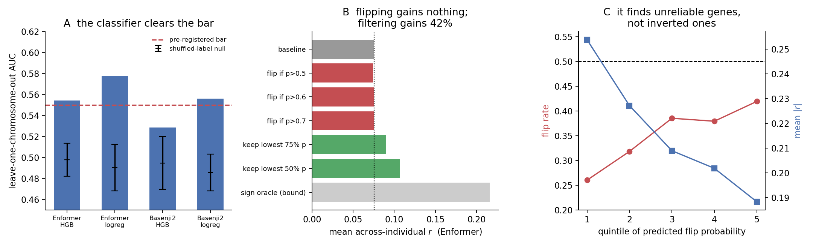

# Half of the personal-genome failure of sequence-to-expression models is a sign error

Sequence-to-expression models (Enformer, Basenji2, ExPecto, Xpresso) are known to do
badly at explaining expression *across individuals*: Huang et al. 2023 report a mean
across-individual Spearman of **0.045** for Enformer on GEUVADIS, versus 0.57 across
genes. The usual reading is that the models do not read personal sequence at all.

Separating the **magnitude** of the across-individual correlation from its **sign**
says something different.


## Result

On GEUVADIS (421 individuals x 3259 genes):

| model | signed mean *r* | unsigned mean \|*r*\| | locus-swap null | sign accuracy | signed / unsigned |
|---|---|---|---|---|---|
| Enformer | 0.0453 | **0.1471** | 0.0414 | **65.4 %** | 0.357 |
| Basenji2 | 0.0374 | 0.1468 | 0.0413 | 62.0 % | 0.291 |
| ExPecto | 0.0338 | 0.1437 | 0.0413 | 61.3 % | 0.264 |
| Xpresso | 0.0068 | 0.1362 | 0.0411 | 52.4 % (chance) | 0.061 |
| PrediXcan | 0.2485 | 0.2605 | 0.0404 | 96.4 % | 0.959 |

The signed mean reproduces the published 0.045. The unsigned mean is **3.55x its
locus-swap null**. At BH-FDR 5 %, **54.5 % of genes carry a real across-individual
signal — and 34.7 % of those point the wrong way.**

So the models are not blind to personal sequence. They localise the signal to the
right locus and then get the direction wrong about a third of the time.

Sign accuracy is monotone in model class: Enformer 65.4 % > Basenji2 62.0 % >
ExPecto 61.3 % > Xpresso 52.4 %. Xpresso only sees the promoter, and its sign sits
exactly at chance — an internal consistency check on the measure.

If the signs were corrected, Enformer would move 0.045 -> 0.147, closing about **half**
the gap to the PrediXcan elastic-net baseline. Sign is roughly half the problem;
effect-size calibration is the other half.

## Controls

| control | what it does | outcome |
|---|---|---|
| population structure | regress out 5 population dummies; separately drop YRI (EUR-only) | ratio 3.78 -> 3.80 / 3.76 / 3.80, unchanged |
| global individual factor | regress out top 1 / 5 / 20 individual-level PCs of the prediction matrix | 3.75 -> 3.81 -> 3.82 -> 3.76, unchanged |
| **locus specificity** | pair gene *g*'s expression with the prediction for a gene *g'* on a different chromosome | \|*r*\| collapses 0.147 -> 0.0414 (label-permutation null 0.0390) |

The third is the decisive one: it keeps every individual's identity and breaks only the
gene-to-locus pairing. The signal collapsing to the null means the models really are
responding to sequence at the correct locus.

## Where the sign error comes from

**Ruled out — a fixed polarity prior.** Flip rate does not depend on the true eQTL
effect direction (Enformer: 36.3 % when eQTL *r* > 0, 34.0 % when *r* < 0, overlapping
CIs). The easiest thing to fix is not the problem.

**Partly supported — distance.** Within 0–20 kb the flip rate rises with lead-eQTL
distance to the TSS (Basenji2 31 % -> 45 %, non-overlapping CIs; Enformer 32 % -> 40 %).
Xpresso is flat at ~47–49 % everywhere, as a promoter-only model should be.
Caveat: the eQTL annotation used here tops out at 19,977 bp, so the genuinely distal
regime that Karollus et al. 2023 describe is **not** tested.

**Strongly supported — the error is shared across architectures.** Among the 822 genes
significant in all four models:

| models flipping | observed | expected if independent |
|---|---|---|
| 0 | 192 | 119.8 |
| 1 | 252 | 298.5 |
| 2 | 201 | 275.4 |
| 3 | 111 | 111.6 |
| **4** | **66** | **16.8** |

All four flipping together is **3.9x** the independence expectation; pairwise sign
concordance Enformer-Basenji2 is **0.710** (chance 0.5). A transformer at 196 kb, a
dilated CNN at 131 kb and a 40 kb CNN fail on the *same genes*. The sign error is a
property of the training paradigm, not of the architecture — which is a quantitative
version of the qualitative observation in the literature that fine-tuned Borzoi and
fine-tuned Enformer land in the same place.

## Limitations

1. PrediXcan was fit on this cohort, so the "closes half the gap" figure inherits that
   optimism. The main result does not depend on PrediXcan.
2. The eQTL annotation caps at 20 kb; the distal regime is untested.
3. One cohort, one cell type (LCL), and the 3259 genes were preselected for having a
   significant cis-eQTL, so absolute fractions do not extrapolate genome-wide.
4. A "sign oracle" is not a method. \|*r*\| is an upper bound, not achievable performance.
5. Only the 2021–2023 model generation is covered. Whether Borzoi or AlphaGenome still
   has this is untested here.

## Round 2: the sign is **not** correctable post hoc — and the AUC said otherwise

The obvious follow-up was pre-registered above: train a flip classifier, bar at
AUC 0.55 on held-out chromosomes. It was run. **The bar was cleared and the method
still failed**, which is the more useful result.



Leave-one-chromosome-out, features computable without ever seeing the test gene's
expression (prediction dispersion, reference prediction, cross-architecture agreement):

| target | classifier | LOCO AUC | shuffled-label null | z |
|---|---|---|---|---|
| Enformer | logistic | **0.578** | 0.490 ± 0.022 | +3.97 |
| Enformer | hist-GBM | 0.554 | 0.498 ± 0.016 | +3.57 |
| Basenji2 | logistic | 0.556 | 0.486 ± 0.018 | +4.04 |

Adding the lead-eQTL annotation (distance, MAF, strength) changes nothing — 0.577 vs
0.578 — so the signal is entirely in the Y-free features.

Then the end-to-end test, scored by the metric the field reports:

| policy | mean *r* (Enformer) | Δ |
|---|---|---|
| baseline | 0.0754 | — |
| flip where p > 0.5 | 0.0743 | **−0.0011** |
| flip where p > 0.6 | 0.0751 | −0.0002 |
| flip where p > 0.7 | 0.0754 | **+0.0000** |
| keep lowest-50 % p | **0.1073** | **+0.0319** |
| sign oracle (bound) | 0.2161 | +0.1407 |

**Flipping gains nothing.** The reason is in panel C: across quintiles of predicted
flip probability the flip rate rises 0.260 → 0.419 and **never crosses 0.5**, while
mean |*r*| falls 0.254 → 0.188. No group of genes is reliably *inverted*; the
classifier only finds genes where the model is closer to a coin flip. Negating a group
that is 42 % flipped makes it 58 % flipped.

So: an AUC significantly above its own shuffled-label null, and zero usable gain. The
discriminable quantity was *unreliability*, not *direction*. **The sign error is not a
systematic bias with a cheap post-hoc fix — it has to be addressed in training**,
which is consistent with it being shared across architectures.

### What did survive: Y-free reliability triage

Ranking genes by the same score and keeping the most reliable half raises Enformer's
mean *r* from 0.0754 to 0.1073 (**+42 %**) and Basenji2's from 0.0647 to 0.0916
(+42 %), against a random-50 % null of 0.0754 ± 0.0058 (z = +5.7). You can tell in
advance, with no expression data, which genes the model's personal-genome prediction
is worth trusting.

A single feature does as well as the trained classifier, and the ranking is odd:

| triage score for **Enformer** | mean *r* kept | Δ | z |
|---|---|---|---|
| **ExPecto** prediction dispersion | 0.1085 | +0.0331 | +5.70 |
| ExPecto IQR | 0.1068 | +0.0314 | +5.42 |
| Enformer–Basenji2 agreement | 0.1027 | +0.0273 | +4.71 |
| Basenji2 dispersion | 0.1017 | +0.0263 | +4.53 |
| *Enformer's own dispersion* | 0.0932 | +0.0178 | +3.07 |

**A different model's dispersion predicts Enformer's reliability better than
Enformer's own does.** Xpresso-derived features are useless or harmful, matching its
chance-level sign accuracy. Caveat: in the per-feature table a couple of degenerate
folds leave one row (`*_nuniq`) with no split; nothing is drawn from those rows.

### Next

The remaining honest route needs the model in the loop rather than its outputs: take
an *external* cis-eQTL map (GTEx, eQTLGen — independent of the target cohort), run the
model on both alleles of the lead variant, and align the model's own response
direction to the external effect direction. That fixes the sign without ever touching
the target cohort's expression. It needs genotypes and GPU inference, unlike
everything here.

Also untested: whether Borzoi / Flashzoi / AlphaGenome still have the sign problem.

## Reproducing

Everything runs on CPU in a few minutes. No GPU, no genome download.

```bash
git clone https://github.com/ni-lab/personalized-expression-benchmark.git upstream
curl -o g1k.ped https://ftp.1000genomes.ebi.ac.uk/vol1/ftp/technical/working/20130606_sample_info/20130606_g1k.ped

P=upstream/predictions; D=upstream/data; R=results
python -I scripts/01_sign_test.py        $P $R 200
python -I scripts/02_ancestry_control.py $P g1k.ped $R 100
python -I scripts/03_mechanism.py        $P $D/eqtl_features.csv $R
python -I scripts/04_locus_swap.py       $P $D/gene_list.csv $D/eqtl_features.csv $R 30
python -I scripts/05_summary_figure.py   $R
python -I scripts/06_flip_classifier.py       $P $D/gene_list.csv $D/eqtl_features.csv $R
python -I scripts/07_does_correction_help.py  $P $D/gene_list.csv $R
python -I scripts/08_triage.py                $P $D/gene_list.csv $R
python -I scripts/09_round2_figure.py         $R
```

Predictions, ground truth and the eQTL annotation all ship inside the upstream repo.

## Sources

- Huang et al., *Personal transcriptome variation is poorly explained by current genomic deep learning models*, Nat Genet 55, 2056 (2023). [paper](https://www.nature.com/articles/s41588-023-01574-w) · [data & code](https://github.com/ni-lab/personalized-expression-benchmark)
- Sasse et al., *Benchmarking of deep neural networks for predicting personal gene expression from DNA sequence highlights shortcomings*, Nat Genet 55, 2060 (2023). [paper](https://www.nature.com/articles/s41588-023-01524-6)
- Karollus, Mauermeier & Gagneur, *Current sequence-based models capture gene expression determinants in promoters but mostly ignore distal enhancers*, Genome Biol 24, 56 (2023). [paper](https://doi.org/10.1186/s13059-023-02899-9)
- Spiro et al., *A scalable approach to investigating sequence-to-function predictions from personal genomes*, Nat Methods 23, 1308 (2026). [paper](https://www.nature.com/articles/s41592-026-03124-8)

A Chinese write-up of the same material is in [REPORT.zh.md](REPORT.zh.md).
